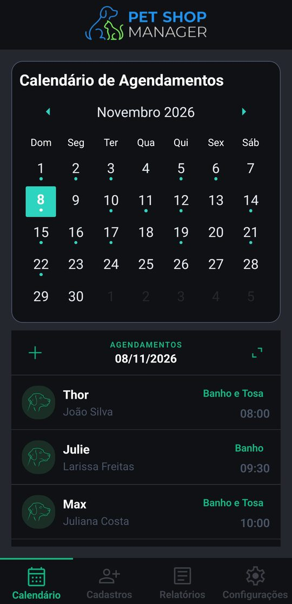
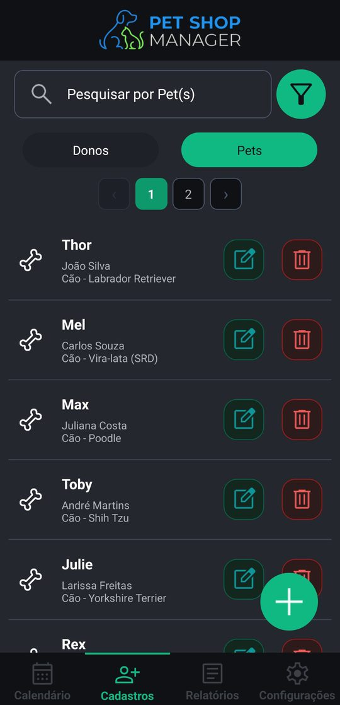
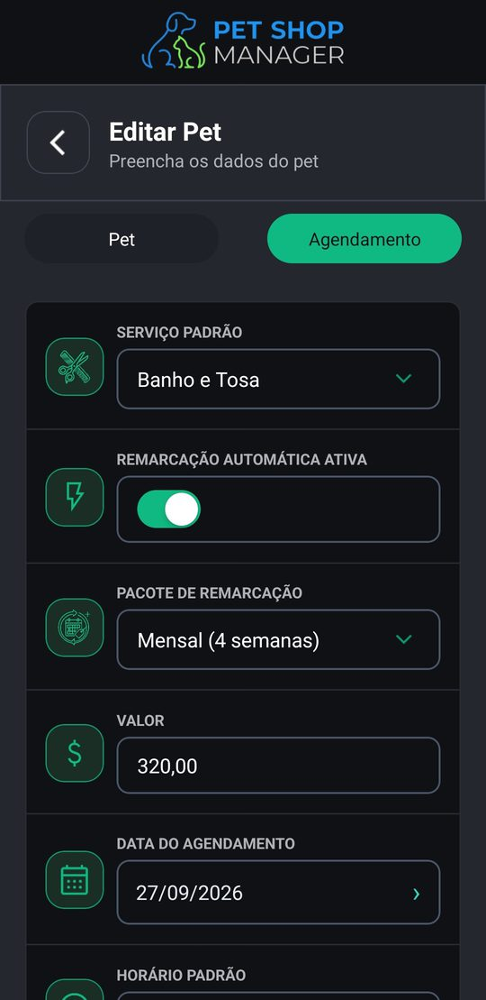
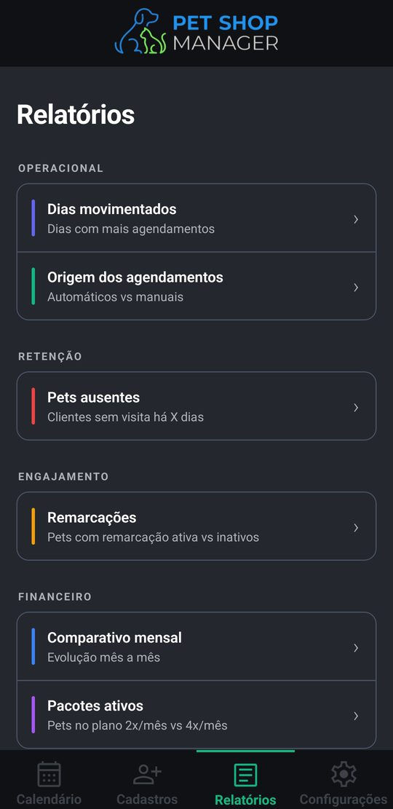
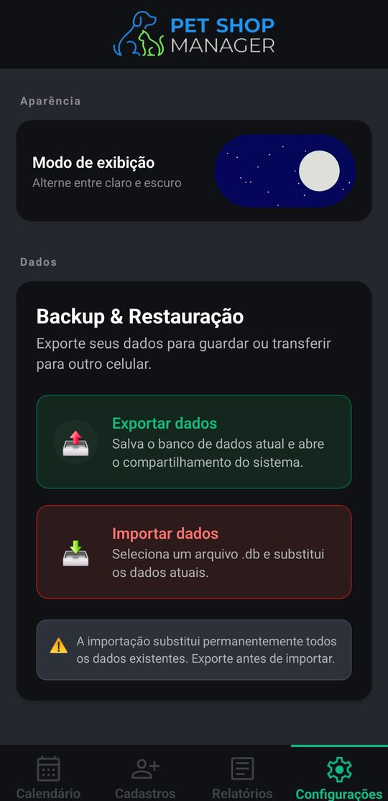
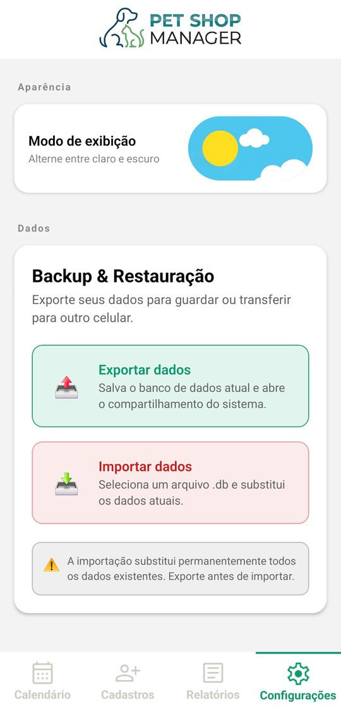

# PetShop Manager

App Android para um pet shop organizar donos, pets e a agenda de banho e tosa, com pacotes que se remarcam sozinhos. Funciona offline: os dados ficam num banco SQLite no próprio aparelho, sem servidor nem login.

Feito para o uso interno de um pet shop, seguindo os requisitos dele, como a remarcação automática dos pacotes. Também foi o projeto da disciplina de Desenvolvimento Mobile, na Unipar.

Só para Android.

## Telas

Prints com os dados de exemplo do próprio app.

| Calendário | Pets | Pacote do pet |
| :---: | :---: | :---: |
|  |  |  |
| **Relatórios** | **Configurações (escuro)** | **Configurações (claro)** |
|  |  |  |

## Funcionalidades

- **Cadastros de donos e pets:** espécie, raça (dá para criar novas), porte e serviço padrão. Desativar um dono desativa os pets dele, e os cadastros nunca são apagados de verdade.
- **Agenda com calendário:** cada agendamento tem serviço, horário, táxi dog, valor, forma de pagamento e se foi pago.
- **Pacotes com remarcação automática:** um pet pode ter pacote de 2 ou 4 atendimentos por mês. O app gera a agenda do pacote e, ao concluir um atendimento, cria o próximo.
- **Seis relatórios com gráficos:**
  - dias e horários mais movimentados;
  - pets ausentes;
  - remarcações;
  - origem dos agendamentos;
  - comparativo mensal;
  - pacotes ativos.
- **Tema claro e escuro.**
- **Backup por arquivo:** exporta o banco pelo compartilhamento do Android e importa um arquivo `.db`.
- **Dados de exemplo:** com o app vazio, um toque em Configurações cria donos, pets, pacotes e agendamentos fictícios. Assim o calendário e os relatórios aparecem com movimento.

## Stack

- Expo SDK 58 (`expo` 58.0.23), React Native 0.88.1 e React 19.3.0.
- TypeScript 6.0.3 em modo `strict`.
- React Navigation 7 (`native-stack`) para a navegação.
- `expo-sqlite` para o banco local e `react-native-calendars` para o calendário.
- Zod 4 para validar a entrada, com um schema por entidade.
- `expo-file-system`, `expo-sharing` e `expo-document-picker` para o backup.
- Build Android pelo EAS: o perfil `preview` gera APK, e o `production` gera AAB.
- Testes com `node:test` e `node:sqlite`, sem dependências.
- ESLint 9 (`eslint-config-expo`, com a ordem das camadas) e Prettier 3.
- GitHub Actions: typecheck, lint, formatação, testes e pacote Android a cada pull request.

## Como funciona por dentro

- **Camadas:** telas → controllers (validação pelos schemas de `src/validation/`) → services → repositories (SQL com parâmetros) → SQLite.
- **Banco:**
  - oito tabelas: donos, pets, agendamentos, serviços, formas de pagamento, espécies, raças e configurações;
  - desativar é exclusão lógica;
  - a cascata fica em triggers do SQLite, e a remarcação, numa função TypeScript pura e testada.
- **Remarcação automática:**
  - o pacote 2 cai a cada 14 dias, e o pacote 4, a cada 7, sem passar da cota do mês;
  - quando a cota acaba, o próximo vai para o mês seguinte, no mesmo dia da semana;
  - a agenda é gerada até 224 dias à frente;
  - o valor de cada atendimento é o do pacote dividido pela quantidade.

Os detalhes estão em [`docs/arquitetura.md`](docs/arquitetura.md). A revisão feita depois da disciplina, item por item, está em [`docs/plano-de-melhorias.md`](docs/plano-de-melhorias.md), e o porquê de cada escolha, em [`docs/decisoes.md`](docs/decisoes.md).

## Como rodar

Requisitos:

- Node 24 e npm;
- um Android com o Expo Go atual, ou um emulador Android.

Para instalar as dependências e subir o servidor do Expo:

```bash
npm ci
npm start
```

Depois, é só ler o QR code com o Expo Go. Com um emulador aberto, `npm run android` abre o app nele.

No modo de desenvolvimento, Configurações tem o botão "Apagar tudo e carregar exemplo", que recria o banco do zero com os dados de exemplo. Ele não existe no APK.

Os testes rodam o esquema do banco e os dados de exemplo num SQLite em memória, com o `node:test` e o `node:sqlite` do Node 24, sem nenhum pacote a mais:

```bash
npm test
```

As mesmas checagens do CI (typecheck, lint, formatação, testes e pacote Android) rodam com:

```bash
npm run check
```

## Equipe

Feito em equipe, com as responsabilidades divididas:

- [Gabriel Maran](https://github.com/Gabriel-Maran): a base do app (Expo, SQLite e as camadas), o calendário, Cadastros com busca e paginação, a remarcação automática, os relatórios, o tema claro e escuro, o backup e, depois da disciplina, a revisão do código (testes, migrações, validação e navegação).
- [João Pedro Uhry Gonçalves](https://github.com/joaopug): os donos, a tela de agendamento (criação, edição, valores e pagamento), os dias marcados no calendário e os componentes dos formulários (campos, `Toggle`, seletor de data e máscaras).
- [Gustavo Grosbelli](https://github.com/Grosbelli12): o cadastro de pets (espécie, raça, porte e observações), o seletor de dono e as imagens e os ícones das telas.

## Contribuindo

O `main` só recebe mudanças por pull request, com o CI verde, e o merge é por squash. As mensagens de commit seguem o [Conventional Commits](https://www.conventionalcommits.org/pt-br/), como `fix(app.json): ...`.

