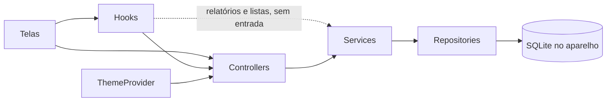

# Arquitetura atual

Retrato do código em 2026-11-05, no commit `e1d5f2f` do `main`. Descreve o que existe hoje, não o que deveria existir. O que muda está em [`plano-de-melhorias.md`](plano-de-melhorias.md).

Depois desse retrato, o PR #1 subiu o projeto para o SDK 58, com React Native 0.88.1, React 19.3.0 e TypeScript 6.0.3, e o PR #5 criou o CI. As versões atuais estão no [`README`](../README.md). O resto deste documento continua valendo.

## O que é

App Android para um pet shop organizar donos, pets e a agenda de banho e tosa. Funciona offline: os dados ficam num banco SQLite gravado no próprio aparelho. Não há servidor, login nem sincronização.

## Stack

Versões do `package.json`:

- Expo SDK 58 (`expo` 58.0.23), React Native 0.88.1 e React 19.3.0, com a nova arquitetura ligada (`newArchEnabled`).
- TypeScript 6.0.3 em modo `strict`, com `noUnusedLocals` e `noUnusedParameters`.
- `expo-sqlite` 58 para o banco, `react-native-calendars` para o calendário e Zod 4 para a validação de entrada.
- `expo-file-system`, `expo-sharing` e `expo-document-picker` para o backup.
- Build Android pelo EAS: perfil `preview` gera APK e `production` gera AAB.

Checagens: `npm run check` roda o typecheck, o ESLint (`eslint.config.js`: regras do Expo, hooks, sem `any` e a ordem das camadas), o Prettier, os testes (`node:test` com `node:sqlite` em memória) e o pacote Android; o mesmo roda no CI a cada PR. `npm run format` formata o código.

## Pastas

```
index.ts                  registra o App no Expo
App.tsx                   providers, abertura do banco e troca de telas
app.json, eas.json        configuração do Expo e perfis de build
src/                      o código do app (era app/ até o ARQ-1, PR #42)
  config/
    database.ts           conexão única, com WAL e pragmas; initDatabase aplica as migrações, recreateAppDatabase recria o banco, e upgradeBackupFile e restoreAppDatabase importam um backup
    schema.ts             pragmas da conexão e a lista de migrações, sem o Expo (desde 2026-11-08)
    migrations/           uma versão do esquema por arquivo (v1.ts a v7.ts), em SQL puro
    migrator.ts           aplica as migrações pendentes numa transação e recria o banco do zero, sem o Expo (desde 2026-11-08)
    backupRestore.ts      atualiza a cópia de um backup pelas migrações e troca os dados do app pelos dela, sem o Expo (desde 2026-11-08)
    demoData.ts           dados de exemplo com datas em torno de hoje (desde 2026-11-08)
    navigation.ts         as telas (`Screen`), as abas da barra de baixo (`TAB_SCREENS`, PR #36) e o mapa de para onde cada uma volta, sem o React Native (desde 2026-11-09)
    petEnums.ts           os valores fixos do pet (serviço, pacote, espécie e porte) como objetos `as const`, sem o React Native (PR #38)
    consts.ts             tipos, imagens da barra e tamanhos; reexporta o `Screen` e os valores do pet
  domain/                 regras puras, sem SQLite, Expo nem React: packageSchedule.ts calcula a agenda do pacote (ARQ-2, PR #47)
  model/                  interfaces das tabelas e builders; Search.ts tem a busca por nome e a página com o total (desde 2026-11-09); Breed.ts tem a raça (PR #38)
  repository/             SQL de cada tabela; ReportsRepository lê os relatórios (PR #46), e PackageScheduleRepository grava a agenda do pacote, sem o Expo (PR #47)
    sql/                  os comandos de escrita, o SQL de todos os relatórios (reportsSql.ts, com `?`, PR #46), o das preferências (settingsSql.ts), o da agenda do pacote e a busca paginada por nome (searchSql.ts) e a de raças (breedsSql.ts, PR #34), que os testes também usam, sem o Expo (desde 2026-11-08)
    fetchPage.ts          roda a página e a contagem de uma busca (desde 2026-11-09)
  service/                repassa as chamadas ao repository, menos as regras da raça (breedRules.ts, sem o Expo, PR #38); BackupService exporta e importa o banco; ReportsService monta as barras dos relatórios, e ServiceTypeService e PaymentMethodService leem as listas do agendamento (PR #46); PackageScheduleService grava o pet ou o agendamento e a agenda do pacote numa transação só, sem o Expo (PR #47)
  controller/             validação e regras de entrada
  validation/             um schema Zod por entidade, os campos comuns (fields.ts) e o parseInput, que vira AppError, sem o Expo (desde 2026-11-09, PR #32)
  errors/
    AppError.ts           o AppError (código e mensagem), o texto da tela e o log, sem o Expo (desde 2026-11-09)
  globals/
    messages.ts           as mensagens que o app mostra ao usuário, uma por falha, e os textos dos modais de confirmação (DIALOGS, PR #34) (desde 2026-11-09)
    limits.ts             limites de entrada, como o tamanho de cada texto (desde 2026-11-09)
    accessibilityLabels.ts os rótulos do leitor de tela (A11Y_LABELS) (desde 2026-11-09)
  hooks/                  useScreen, useBackNavigation, useError, useAsyncAction, useAsyncData, useSearchPage, useFormState e, em data/, as buscas no banco dos formulários
  utils/
    dates.ts              o tipo IsoDate ("AAAA-MM-DD"), o "hoje" no fuso do aparelho, o texto das telas e as contas de calendário (somar dias, dia da semana, mês seguinte) pelo calendário UTC (PR #48), sem o Expo (desde 2026-11-08)
    money.ts              o tipo Cents, a máscara de valor e o campo de texto ↔ centavos, sem o Expo (desde 2026-11-08)
    formatters/           número com vírgula e normalização de nome
    reports/              cálculo puro dos relatórios: as barras e o tipo BarChartItem (charts.ts) e os meses do comparativo (months.ts) (PR #46)
    timeMask.ts           máscara do campo de horário
    openSelectionModal.ts abre o modal de seleção dos formulários
    formDirty.ts          se o formulário mudou desde que abriu, para o voltar só pedir confirmação nesse caso, sem o React Native (PR #36)
  view/
    theme/                a paleta clara e escura (colors.ts), o ThemeProvider e o withAlpha (alpha.ts, PR #35)
    contexts/             o CalendarContext: data e mês selecionados no calendário e a lista do dia
    pages/                telas: HomeScreen, RegistryScreen, ReportsScreen, SettingsScreen e os formulários (appointments/, owner/, pet/); reports/ tem uma tela por relatório
    components/           peças das telas, agrupadas por assunto: accessibility/ (IconButton e props do leitor de tela), appBar/, error/, header/, reports/, searchBar/ e registry/ (campos, botões, seletor de data, listas, modais e abas do pet); o CloseButton é o ✕ dos modais
  assets/                 ícones e imagens, em até 3 vezes o tamanho exibido (cerca de 0,7 MB desde o PERF-1, PRs #44 e #48)
```

## Camadas



- **Telas e componentes** chamam os controllers, quase sempre dentro de `useEffect`, e passam o erro como veio ao `showError` do `useError`. As ações com carregamento usam o `useAsyncAction`, os relatórios carregam pelo `useAsyncData`, e as buscas paginadas por nome, pelo `useSearchPage`, que descarta a resposta atrasada.
- **Controllers** validam a entrada e lançam `AppError` com uma mensagem de `globals/messages.ts` para cada falha. Desde o PR #32, a validação é o schema da entidade em `src/validation/`, pelo `parseInput`: texto com `trim` e tamanho máximo, id, data real, horário `HH:MM`, centavos, e-mail e telefone. O service recebe o tipo que sai do schema. Na edição do pet e do agendamento, o controller lê o registro gravado antes de validar e o passa ao schema (`petSchemaFor` e `appointmentSchemaFor`), que só aplica os limites de texto ao que mudou.
- **Formulários** guardam o valor como o texto do campo ("80,00") e a data como `AAAA-MM-DD`. Ao salvar, o `parseMoneyInput` converte o texto em centavos, e um valor fora do formato vira a mensagem de erro da tela.
- **Services** quase só repassam a chamada ao repository. As exceções:
  - as regras da raça (PR #38): o `SpeciesService` recusa a raça repetida pelo nome sem acento e a espécie que não existe, e o `PetService` confere que a raça do pet é da espécie escolhida;
  - a agenda do pacote (PR #47): o `PetService` e o `AppointmentsService` gravam pelo `PackageScheduleService`, que chama a regra pura de `domain/packageSchedule.ts`;
  - os relatórios (PR #46): o `ReportsService` transforma as contagens do banco nas barras dos gráficos.
- Os relatórios e as listas de serviço e de pagamento não têm entrada do usuário para validar, então as telas e os hooks chamam o service direto, sem controller, como já faziam o backup e os dados de exemplo (PR #46).
- **Repositories** fazem o SQL com parâmetros `?` e devolvem os registros com `SELECT *`. A busca paginada por nome devolve a página e o total juntos, montados pela mesma função, com o mesmo filtro.

## Navegação

React Navigation com uma pilha nativa (`native-stack`), desde o ARQ-3 (2026-11-12). O `App.tsx` registra as telas, sem cabeçalho da biblioteca, e o `useScreen` dá a tela, os parâmetros, o `navigate` e o `goBack`.

- A regra da pilha é pura e testada (`planNavigation`, em `config/navigation.ts`): uma aba recomeça a pilha com o Calendário embaixo, para o voltar de qualquer aba levar a ele; o Calendário fica sozinho; formulários e o relatório aberto entram no topo, e o voltar os tira, mantendo a tela de baixo como estava.
- O Calendário recarrega a agenda ao voltar a ficar em foco (`useFocusEffect`), porque outra tela pode tê-la mudado.
- O voltar do Android é o da biblioteca. Um formulário mudado e a agenda em tela cheia põem uma guarda (`useBackGuard`) enquanto estão em foco, que abre a confirmação ou recolhe a agenda. No Calendário, o voltar fecha o app. Sem gesto de voltar, para a confirmação valer sempre.
- A barra de abas (`AppBar`) fica fora da pilha, aparece só nas quatro abas e navega pelo `navigationRef`.

## Estado global

Três contextos do React:

- **Tema:** sem escolha gravada, segue o tema do sistema (`useColorScheme`, P19); a escolha do usuário fica na tabela `settings` (`theme`: `light` ou `dark`) e vale dali em diante.
- **Erro:** `showError(erro)` abre um modal único, com o texto do `toUserMessage` (ver "Erros").
- **Calendário:** data e mês selecionados e a lista do dia (`useCalendar`).

Os formulários usam `useFormState` (um objeto de estado com `updateField`).

## Banco de dados

Arquivo `petshop.db` (`DATABASE_NAME`), aberto por `getDatabase()` com `journal_mode = WAL`, `foreign_keys` e `recursive_triggers`. Esses dois pragmas valem por conexão, então ficam na abertura, e não no esquema. O `getDatabase()` guarda a promessa da conexão, para as chamadas simultâneas receberem a mesma.

Desde 2026-11-08 (DADOS-1), o esquema tem versão, guardada no `PRAGMA user_version`:

- `MIGRATIONS`, em `schema.ts`, tem uma entrada por versão, em sequência a partir de 1. Uma versão publicada não muda mais: a mudança entra como a seguinte.
- O `initDatabase()` chama o `migrateDatabase()` (`migrator.ts`), que aplica as pendentes numa transação só. Se uma falhar, nada muda, e o erro vai para a tela de erro do `App.tsx`, com o motivo (`cause`) no log.
- O `DatabaseGate` do `App.tsx` roda o `initDatabase()` antes do `ThemeProvider` e das telas, que leem tabelas que a migração pode estar criando. A carga e a tela de erro usam o tema do sistema (`useSystemColors`).
- Durante as migrações, as chaves estrangeiras ficam desligadas, para reconstruir uma tabela sem o `ON DELETE CASCADE` apagar as filhas. No fim, o `foreign_key_check` não pode achar mais problemas que antes.
- A versão 1 é o esquema de antes das migrações, com `IF NOT EXISTS`, e recria os triggers. Num banco antigo sem versão, ela só marca a versão e troca os triggers pelos de hoje.
- A versão 2 corrige os triggers da remarcação (BUG-3 e BUG-4).
- A versão 3 reconstrói `owners`, `pets` e `appointments`: dinheiro em centavos (`INTEGER`), datas em texto `AAAA-MM-DD` e o relógio dos triggers e do `criado_em` no fuso do aparelho (`'localtime'`). Os dados antigos são convertidos na cópia, e a contagem de ids continua de onde parou.
- A versão 4 tira os três triggers da remarcação, que passou para o TypeScript (ARQ-2, PR #47). Nenhum dado muda.
- A versão 5 troca o horário padrão nulo de pets antigos por `00:00`, a regra do formulário e da coluna, porque o nulo impedia concluir o automático do pacote (PR #49).
- A versão 6 põe a integridade no banco (DADOS-4, PR #53, ajustada no PR #56 antes de chegar a um aparelho):
  - `CHECK` nos flags (0 ou 1), no porte, nos horários (`HH:MM`) e no dinheiro (`valor >= 0` no agendamento e `valor_pacote >= 0` no pet, com o nulo do pacote passando); `NOT NULL` no `horario_padrao` do pet;
  - o serviço (do pet e do agendamento) e a forma de pagamento são gravados pelo id, com chave estrangeira. O agendamento guarda também o nome da época, em `servico_nome` (obrigatório) e `tipo_pgto_nome`, e o `CHECK` exige que o id e o nome do pagamento sejam nulos juntos. A leitura mostra o nome gravado, sem JOIN, então renomear um item da lista não muda o histórico;
  - `service_type` e `payment_methods` ganham `is_ativo`. O nome que algum agendamento usa e que não estava na lista entra nela oculto (`is_ativo = 0`); os três serviços de `TipoServico` são garantidos e ativos. As listas do formulário trazem só os ativos;
  - o dado antigo é corrigido na cópia, pela regra do app: o que a correção joga fora (porte e serviço padrão que não são do formulário, horário fora do formato, dinheiro negativo, que vira 0) vai em uma nota no fim da `observacoes` do pet ou da `observacao` do agendamento, e a observação que já existia fica intacta;
  - o nome da forma de pagamento passa a ser único, e o `idx_appointments_pet_id`, que repetia o começo de outro índice, saiu.
- A `v6.ts` foi editada no lugar, e não substituída por uma versão 7, só porque nenhum aparelho a tinha aberto (ver `decisoes.md`). Daqui em diante está congelada.
- A versão 7 passa tabelas, colunas e códigos para o inglês (NOMES-1, 2026-11-11): `race`, `service_type` e `configs` viram `breeds`, `services` e `settings`; cada coluna fica igual ao campo do modelo (`owner_id`, `is_active`, `package_frequency`...); espécie e porte gravam `DOG`/`CAT`/`OTHER` e `SMALL`/`MEDIUM`/`LARGE`/`EXTRA_LARGE`. A `configs` vira a `settings` (chave e valor), e o modo escuro ligado vira `theme = dark`. Ids e contagem de ids ficam. As versões 1 a 6 seguem com os nomes em português da época; os testes de migração montam esses bancos com os comandos daquela época.
- Um banco de versão mais nova que o app é recusado.
- O `migrator.ts` não usa o Expo: os testes rodam o mesmo código com o `node:sqlite`.

Reset de desenvolvimento (desde 2026-11-08): com dados no app e só com `__DEV__`, o cartão de dados de exemplo em Configurações vira "Apagar tudo e carregar exemplo". O `resetToDemoData` (`DemoDataService`) confere o `__DEV__`, chama o `recreateDatabase`, que apaga todas as tabelas e aplica todas as migrações na mesma transação, e depois carrega os dados de exemplo.

### Tabelas

| Tabela | Para que serve |
| --- | --- |
| `settings` | preferências, por chave e valor; hoje só o tema (`theme`), gravado quando o usuário escolhe |
| `services` | serviços: Banho, Banho e Tosa, Banho e Higiênica, e os nomes antigos que a migração manteve ocultos (`is_active = 0`) |
| `payment_methods` | formas de pagamento: crédito, débito, dinheiro, PIX e outro, e os nomes antigos ocultos |
| `species` | espécies: cão, gato e outro |
| `breeds` | raças por espécie, 23 de partida, e o usuário pode criar mais |
| `owners` | donos: nome, telefone, e-mail, endereço e ativo |
| `pets` | pets: espécie, raça, porte, dono, serviço padrão e os dados do pacote de remarcação |
| `appointments` | agendamentos: pet, serviço (id e `service_name`), data, hora, táxi dog, concluído, automático, valor, forma de pagamento (id e `payment_method_name`) e pago |

Convenções:

- Datas são texto `AAAA-MM-DD` (desde a versão 3). O texto se compara e se ordena como data e entra direto nas funções de data do SQLite. No app, o tipo é o `IsoDate`.
- Horas são texto `HH:MM`, com `00:00` quando não há horário.
- Flags são `INTEGER` 0 ou 1, com `CHECK` (desde a versão 6).
- Dinheiro é `INTEGER` em centavos (desde a versão 3), nunca negativo (`CHECK`, desde a versão 6). No app, o tipo é o `Cents`, e só os campos das telas usam o texto com vírgula.
- Serviço e forma de pagamento são gravados pelo id, com chave estrangeira (desde a versão 6). O agendamento guarda também o nome da época (`service_name` e `payment_method_name`) e é esse nome que a leitura mostra. O pet guarda só o id do serviço padrão, porque é configuração de hoje, e não histórico.
- Ao gravar, o id é achado pelo nome entre os itens ativos. Ao editar sem trocar o nome, o id fica, mesmo que o item tenha sido renomeado ou ocultado. A conferência das listas (`assertAppointmentChoices`) aceita o nome igual ao gravado, mesmo oculto; na criação ou na troca, só item ativo.
- Na edição, os limites de tamanho da observação (do pet e do agendamento), do serviço e da forma de pagamento valem só para o que mudou, porque a nota da migração e o nome oculto podem passar do limite normal. O schema mantém um teto alto (`MAX_STORED_TEXT_LENGTH`), e o campo da tela abre a observação já gravada inteira.
- Desativar é exclusão lógica (`is_active = 0`). Nada é apagado de verdade, exceto agendamentos automáticos pendentes.
- `appointments.weekday` é uma coluna gerada, usada pelo relatório de dias mais movimentados.
- São 11 índices de consulta, pensados para os relatórios e as buscas por nome normalizado, mais o único do nome da forma de pagamento.

### Triggers

| Trigger | Quando dispara | O que faz |
| --- | --- | --- |
| `trg_last_visit` | `completed` de 0 para 1 (desde a versão 2) | grava a data como última visita do pet |
| `trg_pet_reschedule_off` | remarcação de 1 para 0 | apaga os automáticos pendentes a partir de amanhã |
| `trg_owner_deactivate_pets` | dono desativado | desativa os pets do dono |
| `trg_pet_activate_owner` | pet ativado | reativa o dono, se estiver inativo |
| `trg_pet_deactivate_clear_package` | pet desativado | apaga os automáticos futuros e desliga o pacote |

### Remarcação automática

É a regra mais elaborada do app. Desde a versão 4 do esquema (ARQ-2, PR #47), ela vive em `src/domain/packageSchedule.ts`, uma regra pura e testada, e o `PackageScheduleService` grava o pet ou o agendamento e a agenda na mesma transação. Até a versão 3, eram três triggers SQL; os que sobraram só apagam (desligar o pacote, desativar o pet), fazem a cascata ou gravam a última visita.

- Pacote 2 (`PackageFrequency.Biweekly`) é a cada 14 dias (até 2 por mês). Pacote 4 (`Weekly`) é a cada 7 dias (até 4 por mês).
- Quando a cota do mês acaba, o próximo cai no mês seguinte, no mesmo dia da semana da data de início.
- A agenda é gerada até hoje + 224 dias (`SCHEDULE_HORIZON_DAYS`). Datas que já passaram entram como agendamento manual.
- O valor de cada atendimento é o valor do pacote dividido pela quantidade do pacote, em centavos, com a sobra para os primeiros do mês.
- Editar um campo da agenda refaz os automáticos pendentes só de hoje em diante (BUG-4); salvar de novo um concluído não cria outro (BUG-3).
- Ao concluir um agendamento automático, o service cria o seguinte.

Um teste de equivalência roda os mesmos passos num banco da versão 3, com os triggers, e num da versão 4, e exige as tabelas iguais, linha a linha.

## Relatórios

Seis relatórios, cada um com uma tela em `view/pages/reports`, o SQL em `repository/sql/reportsSql.ts` e as barras montadas pelo `ReportsService` (PR #46):

- Dias e horários mais movimentados (agendamentos concluídos por dia da semana e por hora).
- Pets ausentes: dias desde a última visita, separados entre pets com e sem pacote.
- Remarcações: pets ativos com e sem pacote.
- Origem dos agendamentos: manuais e automáticos, concluídos e pendentes.
- Comparativo mensal: concluídos nos últimos 12 meses e agendados nos próximos.
- Pacotes ativos: pets em 2x e 4x por mês, com a lista.

Os gráficos são um componente próprio (`BarChart`), sem biblioteca.

## Backup

Fica em Configurações (`DatabaseTransfer` e `BackupService`):

- **Exportar:** um modal avisa que o arquivo não tem senha e traz nome, telefone, e-mail e endereço dos clientes (SEG-1, PR #45). Confirmado, o app consolida o WAL, copia o `petshop.db` para `backups/petshop-AAAA-MM-DD.db`, no cache, e abre o compartilhamento do sistema. Cada exportação apaga as cópias anteriores; a última fica no cache privado do app até a próxima, porque o app de destino pode ler o arquivo depois que o menu fecha.
- **Importar:** o usuário escolhe um arquivo `.db`, que é copiado para a pasta dos bancos do app. Desde 2026-11-08 (etapa 3c), a cópia é aberta numa conexão só dela e passa pelas mesmas migrações do banco do aparelho (`backupRestore.ts`): um backup de versão anterior chega no formato de hoje, e um arquivo danificado (`integrity_check`), sem as sete tabelas do app que todo backup tem (com os nomes de hoje ou os de antes da versão 7) ou de versão mais nova é recusado antes de mexer nos dados. Depois, o app anexa a cópia com `ATTACH` e confere se ela tem todas as colunas do app. Numa transação, com as chaves estrangeiras e os triggers do app desligados, apaga e copia as oito tabelas (as sete e a `payment_methods`) pelo nome das colunas, e a contagem de ids. A cópia e os arquivos do SQLite ao lado dela são apagados no fim, com qualquer resultado.
- O backup automático do Android está desligado (`android.allowBackup: false`, SEG-1, PR #45): o banco só sai do aparelho pela exportação manual. A transferência direta entre celulares, no Android 12 ou mais novo, continua possível.
- Todas as conexões abrem com o `trusted_schema` desligado (`SQL_CONNECTION_PRAGMAS`), para o esquema de um arquivo de fora não rodar função com efeito colateral.

## Tema e estilo

As cores ficam em `view/theme/colors.ts`, num objeto `light` e outro `dark`, e os componentes montam o estilo com `useThemedStyles(styles)`, do `ThemeProvider`. Desde 2026-11-09 (A11Y-1), um teste confere o contraste de 4,5:1 de cada par de texto e fundo nos dois temas. Tamanhos de fonte, espaços e raios são escritos em cada componente. Desde o PR #35, as cores do interruptor do tema, do destaque dos relatórios, da bolinha do `Toggle`, da sombra e do fundo dos modais também estão no tema, e a transparência sai do `withAlpha`. Ainda ficam fora algumas sombras `#000` e o fundo do filtro ativo (ver `proximos-passos.md`).

Acessibilidade: botão só com ícone usa o `IconButton` (ou o `ActionIconButton`), com papel, rótulo de `A11Y_LABELS` e área de toque de 48 dp, e os enfeites usam `HIDDEN_FROM_SCREEN_READER`.

## Erros

Desde 2026-11-09 (ERRO-1), num lugar só, em `src/errors/AppError.ts`:

- **Criar:** a falha prevista é um `AppError`, com um código (`VALIDATION`, `NOT_FOUND`, `CONFLICT`, `INVALID_BACKUP`, `DATABASE` ou `UNAVAILABLE`) e uma mensagem de `src/globals/messages.ts`. O motivo de verdade, quando há, fica no `cause`.
- **Mostrar:** o `toUserMessage` devolve a mensagem do `AppError`. Qualquer outro erro (um bug, o SQLite, o Expo) vira "Algo deu errado. Tente de novo.", para a tela não mostrar SQL nem detalhe interno.
- **Registrar:** o `logError` manda para o log o erro inesperado inteiro e o `AppError` com `cause`. A falha de validação é prevista e não vai para o log.
- **Nas telas:** o `showError` do `ErrorProvider` recebe o erro como veio e faz as duas coisas. O `useAsyncAction` liga o carregamento, barra o toque duplo e mostra a falha; o `useAsyncData` carrega os dados de uma tela ao abrir e mostra a falha uma vez só.
- O backup, os dados de exemplo e o cadastro de raça usam o mesmo modal das outras telas.
- A falha na abertura do banco aparece na tela de erro do `App.tsx`, com a mensagem do `AppError` ou a de "não foi possível abrir os dados do app".
- Os erros de programação (migração fora de ordem, hook fora do provider) continuam como `Error`, porque não são do usuário.

## Build e release

- `app.json`: nome "PetShop Manager", pacote `com.gabriel98989898.PetShopManager`, retrato, ícone e splash próprios.
- `eas.json`: `preview` gera APK, `production` gera AAB. Sem versão mínima do EAS CLI e sem incremento automático de versão.
- O app não tem suporte a web. O script `web` saiu do `package.json` no REPO-3, mas o bloco `web` do `app.json` continua.
- Não há release publicada no GitHub.
