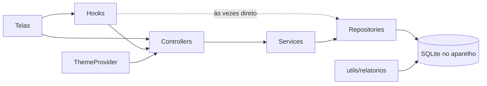

# Arquitetura atual

Retrato do código em 2026-11-05, no commit `e1d5f2f` do `main`. Descreve o que existe hoje, não o que deveria existir. O que muda está em [`plano-de-melhorias.md`](plano-de-melhorias.md).

Depois desse retrato, o PR #1 subiu o projeto para o SDK 58, com React Native 0.88.1, React 19.3.0 e TypeScript 6.0.3, e o PR #5 criou o CI. As versões atuais estão no [`README`](../README.md). O resto deste documento continua valendo.

## O que é

App Android para um pet shop organizar donos, pets e a agenda de banho e tosa. Funciona offline: os dados ficam num banco SQLite gravado no próprio aparelho. Não há servidor, login nem sincronização.

## Stack

Versões do `package.json`:

- Expo SDK 54 (`expo` 54.0.33), React Native 0.81.5 e React 19.1.0, com a nova arquitetura ligada (`newArchEnabled`).
- TypeScript 5.9.2 em modo `strict`.
- `expo-sqlite` 16 para o banco, `react-native-calendars` para o calendário.
- `expo-file-system`, `expo-sharing` e `expo-document-picker` para o backup.
- Build Android pelo EAS: perfil `preview` gera APK e `production` gera AAB.

Não há lint, formatador, testes nem CI. O único script de checagem possível hoje é o `tsc --noEmit`, e ele falha num arquivo sem uso (ver BUG-1 no plano).

## Pastas

```
index.ts                  registra o App no Expo
App.tsx                   providers, abertura do banco e troca de telas
app.json, eas.json        configuração do Expo e perfis de build
app/
  config/
    database.ts           conexão única, com WAL e pragmas; initDatabase aplica as migrações, e recreateAppDatabase recria o banco
    schema.ts             tabelas, índices, dados iniciais, triggers e a lista de migrações, em SQL puro, sem o Expo (desde 2026-11-08)
    migrator.ts           aplica as migrações pendentes numa transação e recria o banco do zero, sem o Expo (desde 2026-11-08)
    demoData.ts           dados de exemplo com datas em torno de hoje (desde 2026-11-08)
    consts.ts             enums, tipos, telas, imagens da barra e tamanhos
  model/                  interfaces das tabelas e builders
  repository/             SQL de cada tabela
    sql/                  os comandos de escrita que os testes também usam, sem o Expo (desde 2026-11-08)
  service/                repassa as chamadas ao repository; BackupService exporta e importa o banco
  controller/             validação e regras de entrada; ScreenController guarda a tela atual
  hooks/                  useScreen, useError, useFormState e buscas no banco para os formulários
  utils/
    datas.ts              todas as conversões de data e o "hoje" no fuso do aparelho, sem o Expo (desde 2026-11-08)
    dinheiro.ts           máscara de valor, texto ↔ centavos e o formato gravado no banco, sem o Expo (desde 2026-11-08)
    formatadores/         número com vírgula e normalização de nome
    relatorios/           consultas SQL dos seis relatórios
    mascarar.ts           máscara de horário e de valor
    raceSpecieHelper.ts   cria raça nova, com checagem de duplicidade
  view/
    Themes/               cores claras e escuras e o ThemeProvider
    contexts/             data e mês selecionados no calendário
    pages/                telas: Home, Cadastros, Relatórios, Configurações e formulários
    components/           peças das telas, agrupadas por assunto
  assets/                 ícones e imagens (6,7 MB no total)
```

## Camadas



- **Telas e componentes** chamam os controllers, quase sempre dentro de `useEffect`, e mostram o erro pelo `useError`.
- **Controllers** validam a entrada (campos obrigatórios, telefone, porte, pacote, data `YYYYMMDD`) e lançam `Error` com a mensagem em português.
- **Services** só repassam a chamada ao repository. Não há regra de negócio neles.
- **Repositories** fazem o SQL com parâmetros `?` e devolvem os registros com `SELECT *`.
- **Relatórios** ficam em `utils/relatorios` e consultam o banco direto, sem passar pelas outras camadas.
- Os hooks `useServicos` e `useTiposPagamento` chamam o repository direto.
- `config/consts.ts` importa um tipo de `view/` (`BarChartItem`), então a configuração depende da interface.

## Navegação

Não usa biblioteca de navegação. O `ScreenController` é um singleton que guarda a tela atual e os parâmetros e avisa os ouvintes. O hook `useScreen` assina essas mudanças, e o `App.tsx` escolhe a tela num `switch`.

- Não há histórico: cada tela diz para onde volta (`TitleBar` com `returnTo`).
- O botão voltar do Android não é tratado (não há `BackHandler`).
- A barra de navegação inferior (`AppBar`) aparece só nas quatro telas principais.
- Existe também um `ScreenService` com a mesma função, sem uso.

## Estado global

Três contextos do React:

- **Tema:** `isDark` vem da tabela `configs` (registro 1, "Modo Escuro"). O tema não segue o do sistema.
- **Erro:** `showError(mensagem)` abre um modal único.
- **Agendamentos:** data e mês selecionados no calendário e a lista do dia.

Os formulários usam `useFormState` (um objeto de estado com `updateField`).

## Banco de dados

Arquivo `petshop.db` (`DATABASE_NAME`), aberto por `getDatabase()` com `journal_mode = WAL`, `foreign_keys` e `recursive_triggers`. Esses dois pragmas valem por conexão, então ficam na abertura, e não no esquema. O `getDatabase()` guarda a promessa da conexão, para as chamadas simultâneas da abertura do app (o tema e o `initDatabase`) receberem a mesma.

Desde 2026-11-08 (DADOS-1), o esquema tem versão, guardada no `PRAGMA user_version`:

- `MIGRATIONS`, em `schema.ts`, tem uma entrada por versão, em sequência a partir de 1. Uma versão publicada não muda mais: a mudança entra como a seguinte.
- O `initDatabase()` chama o `migrateDatabase()` (`migrator.ts`), que aplica as pendentes numa transação só. Se uma falhar, nada muda, e o erro vai para a tela de erro do `App.tsx`.
- Durante as migrações, as chaves estrangeiras ficam desligadas, para reconstruir uma tabela sem o `ON DELETE CASCADE` apagar as filhas. No fim, o `foreign_key_check` não pode achar mais problemas que antes.
- A versão 1 é o esquema de antes das migrações, com `IF NOT EXISTS`, e recria os triggers. Num banco antigo sem versão, ela só marca a versão e troca os triggers pelos de hoje.
- Um banco de versão mais nova que o app é recusado.
- O `migrator.ts` não usa o Expo: os testes rodam o mesmo código com o `node:sqlite`.

Reset de desenvolvimento (desde 2026-11-08): com dados no app e só com `__DEV__`, o cartão de dados de exemplo em Configurações vira "Apagar tudo e carregar exemplo". O `resetToDemoData` (`DemoDataService`) confere o `__DEV__`, chama o `recreateDatabase`, que apaga todas as tabelas e aplica todas as migrações na mesma transação, e depois carrega os dados de exemplo.

### Tabelas

| Tabela | Para que serve |
| --- | --- |
| `configs` | preferências; hoje só o modo escuro |
| `service_type` | serviços: Banho, Banho e Tosa, Banho e Higiênica |
| `payment_methods` | formas de pagamento: crédito, débito, dinheiro, PIX e outro |
| `species` | espécies: cão, gato e outro |
| `race` | raças por espécie, 23 de partida, e o usuário pode criar mais |
| `owners` | donos: nome, telefone, e-mail, endereço e ativo |
| `pets` | pets: espécie, raça, porte, dono, serviço padrão e os dados do pacote de remarcação |
| `appointments` | agendamentos: pet, serviço, data, hora, táxi dog, concluído, automático, valor, forma de pagamento e pago |

Convenções:

- Datas são `INTEGER` no formato `YYYYMMDD`. Para usar as funções de data do SQLite, o SQL monta o texto com `substr` a cada uso.
- Horas são texto `HH:MM`, com `00:00` quando não há horário.
- Flags são `INTEGER` 0 ou 1, sem `CHECK`.
- Dinheiro é texto com vírgula (`"0,00"`). O trigger converte para `REAL` para dividir o valor do pacote.
- Serviço e forma de pagamento são gravados como texto no agendamento, não como id.
- Desativar é exclusão lógica (`is_ativo = 0`). Nada é apagado de verdade, exceto agendamentos automáticos pendentes.
- `appointments.dia_semana` é uma coluna gerada, usada pelo relatório de dias mais movimentados.
- São 12 índices, pensados para os relatórios e as buscas por nome normalizado.

### Triggers

| Trigger | Quando dispara | O que faz |
| --- | --- | --- |
| `trg_ultima_visita` | `concluido` de 0 para 1 (desde a versão 2) | grava a data como última visita do pet |
| `trg_remarcacao_automatica` | `concluido` de 0 para 1 num agendamento automático (desde a versão 2) | cria o próximo agendamento automático do pacote |
| `trg_pet_remarcacao_insert` | insert de pet com remarcação | gera a agenda do pacote, da data de início até hoje + 224 dias |
| `trg_pet_remarcacao_ativar` | mudança de fato num campo da agenda (pacote ligado, pacote, início, horário, serviço, valor ou `is_ativo`), com remarcação ligada (desde a versão 2) | apaga os automáticos pendentes de hoje em diante e gera de novo só a partir de hoje |
| `trg_pet_remarcacao_desativar` | remarcação de 1 para 0 | apaga os automáticos pendentes a partir de amanhã |
| `trg_owner_desativar_pets` | dono desativado | desativa os pets do dono |
| `trg_pet_ativar_owner` | pet ativado | reativa o dono, se estiver inativo |
| `trg_pet_desativar_limpar_remarcacao` | pet desativado | apaga os automáticos futuros e desliga o pacote |

### Remarcação automática

É a regra mais elaborada do app, e vive inteira nos triggers:

- Pacote 2 é a cada 14 dias (até 2 por mês). Pacote 4 é a cada 7 dias (até 4 por mês).
- Quando a cota do mês acaba, o próximo cai no mês seguinte, no mesmo dia da semana da data de início.
- A agenda é gerada até hoje + 224 dias (`PERIODO_REMARCACAO`). Datas que já passaram entram como agendamento manual.
- O valor de cada atendimento é o valor do pacote dividido pela quantidade do pacote.
- Ao concluir um agendamento automático, o trigger cria o seguinte.

A mesma lógica de calendário aparece em três lugares do SQL: duas vezes no CTE recursivo dos triggers de pet e uma vez no trigger de conclusão.

## Relatórios

Seis relatórios, cada um com uma tela em `view/pages/Relatorios` e a consulta em `utils/relatorios`:

- Dias e horários mais movimentados (agendamentos concluídos por dia da semana e por hora).
- Pets ausentes: dias desde a última visita, com o telefone do dono, separados entre pets com e sem pacote.
- Remarcações: pets ativos com e sem pacote.
- Origem dos agendamentos: manuais e automáticos, concluídos e pendentes.
- Comparativo mensal: concluídos nos últimos 12 meses e agendados nos próximos.
- Pacotes ativos: pets em 2x e 4x por mês, com a lista.

Os gráficos são um componente próprio (`BarChart`), sem biblioteca.

## Backup

Fica em Configurações (`DatabaseTransfer` e `BackupService`):

- **Exportar:** consolida o WAL, copia o `petshop.db` para o cache e abre o compartilhamento do sistema.
- **Importar:** o usuário escolhe um arquivo `.db`. O app anexa o arquivo com `ATTACH`, e numa transação apaga e copia sete tabelas, com as chaves estrangeiras desligadas. Não confere a versão nem a estrutura do arquivo.

## Tema e estilo

As cores ficam em `view/Themes/ThemeProvider.tsx`, num objeto `light` e outro `dark`, e os componentes montam o estilo com `useThemedStyles(styles)`. Tamanhos de fonte, espaços e raios são escritos em cada componente. Algumas cores também (overlays, gráfico, destaque dos relatórios, interruptor do tema).

## Erros

- Controllers lançam `Error` com a mensagem para o usuário.
- As telas pegam o erro e chamam `showError`, com o mesmo `handleError` copiado em cada lugar.
- O `DatabaseTransfer` tem o próprio modal de erro.
- Falhas na criação do banco só vão para o `console.log`.

## Build e release

- `app.json`: nome "PetShop Manager", pacote `com.gabriel98989898.PetShopManager`, retrato, ícone e splash próprios.
- `eas.json`: `preview` gera APK, `production` gera AAB. Sem versão mínima do EAS CLI e sem incremento automático de versão.
- O script `web` existe no `package.json`, mas o app não tem suporte a web.
- Não há release publicada no GitHub.
